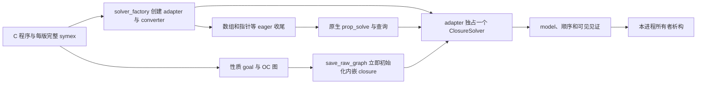
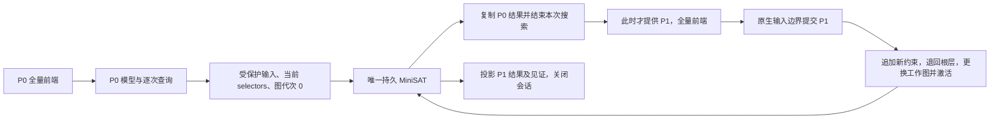

# PI-0 原生入口与会话契约

本预检以 `d8c79eaba5df03b1a013dc6ffbb3a1e249485c1e` 的 eager Closure / SC 路径为准。下面的“计划”均指尚待实现的接口。预检同时保存了文件 SHA-256 和逐行语句，便于从固定源码复查。[原生入口索引](../reports/evidence/pi0/native-sites.json) · [C++11 接口声明](../include/session_contract.h)

## 当前所有权

计划将唯一的 MiniSAT 构造点放入 `PersistentClosureSession::Backend`。按版重建 converter、局部编号和完整模型。计划由前端子进程提交事务、消费本版局部赋值并构造逐性质结果，后端持有唯一 solver，会话协调器在返回前取得全部输出的所有权。前端收集器只编码。第一版每次换图均构造新的 Closure runtime，同 epoch 的动态 CO 绑定来自受保护的不可变扩展账本。

图中的追加发生在无活动搜索、上一查询已退回 Boolean 根层以后。启用新图还需要满足当前合法上下文的完整激活条件。[MiniSAT 与 Closure 声明](../../minisat-2.2.1/minisat/core/ClosureSolver.h#L23)

## 原生入口和所需改动

| 当前代码实际做什么 | 计划的接入点与保护边界 | 固定源码 |
|---|---|---|
| SC 从事件、读写、线程顺序、RF 与 Guard 构建声明。工厂 `get_default` 选择 `deagle_closure_solvert`，adapter 构造函数以 `util_make_unique<T>()` 持有内核。 | 前端保留原模型生成顺序。工厂在会话模式创建每版收集 adapter，将内核所有权上移。 | [SC](../../src/goto-symex/memory_model_sc.cpp) · [工厂](../../src/goto-checker/solver_factory.cpp#L218) · [adapter 构造](../../src/solvers/sat/satcheck_minisat2.cpp#L336) |
| `lcnf` 遇 true 提前返回，`convert` 丢弃 false，`add_variables` 根据本版计数调用 `newVar`。`addClause_` 在根层去重、收缩、入队单位，空式可使 `ok=false`。 | 在每个可撤销输入第一次进入内核之前登记完整 occurrence、作用域、常量和局部极性。全局翻译后先加保护，再交给原生根简化。普通程序变量与 selectors、动态 CO 共用唯一分配器、分设角色。 | [输入](../../src/solvers/sat/satcheck_minisat2.cpp#L138) · [根层安装](../../minisat-2.2.1/minisat/core/Solver.cc#L137) |
| `prepare_property_decider` 转换方程和 goals，再从 `oc_edges`、`oc_guard_map` 和位置构建原生图。`run_property_decider` 随后加入所选 goals 的析取。 | 将实际边、端口、Guard、位置、候选目录以及转换产生的 CNF 暂存。本次 goal、阻断输入、额外定义和 assumptions 有自己的查询描述。 | [建图](../../src/goto-checker/bmc_util.cpp#L424) · [查询入口](../../src/goto-checker/bmc_util.cpp#L584) · [goal 析取](../../src/goto-checker/goto_symex_property_decider.cpp#L82) |
| `dec_solve` 首次调用 `finish_eager_conversion`。数组、量词、函数和延迟指针编码可以继续分配变量和 CNF。随后才进入 `prop_solve`。 | 在实际 SAT 边界封存。每版一个新 converter，逐次记录后来查询新增变量、定义及原生 goal/assumptions，处理到所有性质有结果。第一版遇 refine/lazy 多轮细化明确拒绝或冷建。 | [封存边界](../../src/solvers/prop/prop_conv_solver.cpp#L444) · [数组](../../src/solvers/flattening/arrays.h#L41) · [指针](../../src/solvers/flattening/bv_pointers.cpp#L987) |
| `set_assumptions`、converter 的 push/pop 与 `do_prop_solve` 传递查询文字。adapter 对全局不一致和 false 常量有提前返回，支持中断。`l_get`、`set_assignment`、`is_in_conflict` 按局部变量访问状态。 | 合成版本、理论和 query 的全体正负 assumptions，保留原生查询文字和常量语义。false 假设只结束此查询。投影带符号局部值、失败核心和 UNKNOWN，中断退出清理回调和待处理队列。 | [值读取](../../src/solvers/sat/satcheck_minisat2.cpp#L46) · [求解](../../src/solvers/sat/satcheck_minisat2.cpp#L214) · [查询栈](../../src/solvers/prop/prop_conv_solver.cpp#L529) |
| `save_raw_graph` 复制图表并借用调用方顺序表指针，立即调用 `init/set_graph`。另有 `addOC/addGuard/setRawGraph` 原始表写入口。`closure::init` 只重设 owner 和 nodes。 | 上述图入口统一构造 immutable spec。替换 `ClosureSolver::graph` 的内嵌值所有权，析构旧图后创建新代次。清除节点、地址、端口、inactive RF/race、triplet、五套 trail/limit、CO、冲突向量、去重/待传播队列、游标与输出引用。 | [图入口](../../minisat-2.2.1/minisat/core/ClosureSolver.cc#L34) · [其他入口](../../minisat-2.2.1/minisat/core/ClosureSolver.cc#L757) · [图字段](../../minisat-2.2.1/minisat/core/Closure.h#L30) · [init](../../minisat-2.2.1/minisat/core/Closure.cc#L133) |
| `set_graph` 依次登记 guard/race、APO union、RF、静态 PO，建立 CO 对并应用待传播文字。常真 Guard 立即 light，静态 PO 以空动态理由激活。第 99、150 行会直接置 `ok=false`。 | 安装期只保存 spec。上下文实际启用后，初始化单位/冲突也经受保护出口产生。整图矛盾给出 `¬epoch`；带动态条件时保留全部必要文字。 | [初始化](../../minisat-2.2.1/minisat/core/ClosureSolver.cc#L44) · [常真 Guard](../../minisat-2.2.1/minisat/core/Closure.cc#L216) |
| 每次 `search` 开头 `use_available_info` 可以在原生 assumptions 安装前读取已赋值端口、删索引并提前返回 `l_False`。`propagate` 在同一 trail 中做 watcher BCP，再激活边/点，根层会 `remove_rf`，环或 race 冲突由第 526 行分配 CRef。 | 增设独立理论消费位置与 generation。重放根及现有 RF/Guard，带条件冲突交还原生分析。重放前后检查理由时序，初始化/搜索产生的队列在清空前显式消费。 | [搜索开头](../../minisat-2.2.1/minisat/core/ClosureSolver.cc#L218) · [传播](../../minisat-2.2.1/minisat/core/ClosureSolver.cc#L393) · [索引删除](../../minisat-2.2.1/minisat/core/Closure.cc#L1475) |
| 两个 `assign_literal` 重载按结论文字去重，`apply_literal_assignment` 将结论放在位置 0，单位可无 CRef 入队，较长理由分配为 learnt 并附着。 | 队列项一起保存原生有符号 payload、结论、局部 guard 或 epoch、层和代次。保留实际胜出的理由，禁止拼接两个不同理由。实际传给 SAT 的 Clause 必须包含保护文字。已有 true 不重入队，已有 false 走冲突，其余文字为假才传播。 | [原生队列与分配](../../minisat-2.2.1/minisat/core/ClosureSolver.cc#L679) |
| `addMissingCoClauses` 紧靠返回 SAT 前，直接分配两个 `newVar`、一个原始 Clause 并绑定两个方向；候选要求同址、不同原子单元、Guard 点亮、两向尚不可达，race 模式影响候选。 | 全局分配有类型的方向变量，`¬epoch ∨ co12 ∨ co21 ∨ ¬g1 ∨ ¬g2` 保留实际存在的 Guard。按 epoch 和规范端点记录一次双向绑定；同图重建恢复，换图停用。无法安全实现时返回 `UNSUPPORTED_INCREMENTAL_CO` 并单列冷建。 | [候选](../../minisat-2.2.1/minisat/core/Closure.cc#L1241) · [新增变量、子句、绑定](../../minisat-2.2.1/minisat/core/ClosureSolver.cc#L773) |
| `newDecisionLevel/cancelUntil` 同步 Boolean 与图 scope；父类 `addClause_/simplify` 的 `propagate` 为非 virtual 调用。`analyze`、`litRedundant`、`reduceDB`、GC 访问真实理由与存活子句。 | 设显式联合不动点与回滚 hook，继续使用原生简化、冲突分析、成功最小化和 GC。理由 CRef 的生命周期至少到分析/回溯或合法解除；临时冲突句也要能被消费。审计出生编号与 CRef 重定位分开。 | [层和分析](../../minisat-2.2.1/minisat/core/ClosureSolver.cc#L553) · [简化](../../minisat-2.2.1/minisat/core/Solver.cc#L594) · [回收](../../minisat-2.2.1/minisat/core/Solver.cc#L898) |
| `solve_` 在 SAT 时复制 model，`final_check` 产生顺序，写入借用的输出表与进程级 `write_order`。返回前 `cancelUntil(0)`。trace 用本版 `oc_result_order` 还原时间。 | 在回退/销毁可能改变赋值与事件解释之前建立结果快照；随后用拥有本版方程的前端完成逐性质投影和见证。最终检查打印的异常不能当作有效见证。 | [SAT/UNSAT 收尾](../../minisat-2.2.1/minisat/core/ClosureSolver.cc#L341) · [事件顺序](../../minisat-2.2.1/minisat/core/Closure.cc#L1280) · [trace](../../src/goto-symex/build_goto_trace.cpp#L271) |

## 不可变数据与切换

- **变量。** 在每版建立带符号单射，保持 `μ(¬l)=¬μ(l)`。比较匹配见证的完整内容和实际绑定，包括角色别名、端点、方向、位宽、ABI、地址对象与布局。不确定或反向撞号时分配 fresh。常量和缺失端口显式区分。旧 global ID 永不换义，包括搜索期间追加的 CO ID。
- **Boolean 输入。** 规范化的是全局文字内容和作用域。去重复文字、跳过真常量/重言式、删除假常量，保留空句。以完整内容比较确认相等。每种内容一次注册，来源 occurrence 另记，同版多来源用活跃并集。永久安装 `¬s ∨ C`，空句成为永久 `¬s`，可撤销输入单位成为二元句。普通根事实只能源自永久条件化系统。选中的 selectors 是 assumptions。
- **查询。** 保存实际目标和性质集合、展开义务、查询作用域 CNF、临时阻断、原生 assumptions、带符号接口及后续查询增量。完整查询键相等才共享控制量。查询子句采用 `¬q ∨ ¬sᵢ ∨ Cᵢ`，共享条件和子句内容都不可变。完整模型可能包含多个查询，一次原生调用也可以检查多个性质。
- **epoch。** 完整规范内容含实际事件身份/种类、地址与端口、PO/APO/RF/RACE/Guard、块成员及有向边界、候选写全集、当前规则和 ABI/SC 配置。相等性逐字段验证。搜索产生的 CO 是 epoch 拥有的不可变扩展，epoch 键在搜索前封存。一个旧 EPOCH 混合句被停用的 epoch 满足，计入休眠。
- **事务。** `IDLE → INSTALLING → READY → SOLVING → IDLE`。上一查询结果已拥有、无活动搜索且 decision level 为零才切换。先验证模型头、全部绑定、查询及约束，预留 ID，再追加此时停用的 guarded 记录，最后发布完整激活集合。失败的追加保留不可复用的 ID，并保证遗留输入永不激活；若污染了已发布的绑定，进入 FAILED 并销毁会话。未知、中断、冷建分别记账。
- **恢复。** 先撤销旧 assumptions，保留永久 Boolean trail 和原生 watcher/活动度/相位；按新代次重置理论队列和游标。guard 状态须满足完整合法图上下文，含必要停用条件，才允许理论输出。按现有 Boolean 层数补齐图 scope 帧，重放当前真实 trail 达到联合不动点。可将重放影响归入本次激活层，跨过屏障即丢弃整代，恢复后重新建立。不可在没有帧的工作图上调用 `pop_scope(k)`。原生每次 `solve_` 会重设 `max_learnts` 调度和本次重启序列。
- **冲突层级。** 将已为假的传播结论转为带完整保护的冲突。延迟推理可能让最高假文字层低于当前层；先恢复至可分析层并保存仍然有效的永久理由，再执行 UIP 或失败假设处理。纯静态矛盾的 `¬epoch` 可作为永久系统推出的单位在合法根边界处理；不能在非零层调 `addClause_` 或从任意分支返回全局 UNSAT。
- **结果边界。** 一次 assumptions 导致 `l_False` 时，已假假设由 `analyzeFinal` 产生非空 core，`solve_` 的 `status==l_False && conflict.size()==0` 条件不会触发。永久数据库真矛盾才使 `ok` 持续为 false。原生同公式小例实测了两种路径。[原生回执](../reports/evidence/pi0/stock-probe.txt)

对于每个合法激活集合，停用的 `¬s ∨ C` 已满足，启用项恰为本版的 B、理论声明和 Q；未共享的变量可独立延拓。因而在完整守卫和绑定确实成立时，本版投影与原公式等价。追加操作只扩大永久公式，已证明的 guarded reason 及其 CDCL 推论继续成立。候选局部规则还需证明在**每个**满足其声明的上下文都有效。有限两事件例遍历 1,024 种赋值，两个合法图各核对 16 个投影，删除旧 PO 后存在 `RF=true, b<a` 的 P1 反例，否定了未加保护的旧结论。[设计例证](../reports/evidence/pi0/contract-examples.json)

## 局部理由清单

首层一律执行 EPOCH 保护，理由文字保留原生动态条件。后续 LOCAL 的第一批为可独立认证的 PO、RF/Guard 绑定、不经未认证代表元提升的顺序传递与环。WS/FR/三元组的加入以各规则的独立语义检查为条件。任一父理由带 epoch，子理由必须继承；动态条件只在真实原生 reason 中解除。

| 规则和原生路径 | 局部证明必要静态条件 | 触发文字与后备 |
|---|---|---|
| PO 种子，RF 激活，Guard 点亮 | 事件存在、类别、确切 PO；RF 的写读端点、同址、唯一的有符号 RF 绑定；Guard 的有符号端口、受控写集合，区分无条件 Guard。 | RF、Guard 真的 trail 文字保留。涉及动态 CO 或未认证接口走 epoch。 |
| `activate_directed_edge` 传递、自环与顺序环，反向 RF 预防 | 实际父边、共享中点、方向及配置；反向 RF 还要证明该候选的实际端点、角色、绑定及同址。 | 环合取路径上的动态前提；反向传播的结论为 `¬RF`。遍历块成员、代表元提升时须有完整成员及有向 APO 证书，否则 epoch。 |
| `union_join/activate_apo`、块内逆序、跨块提升 | 完整不可分块、成员、边界与 APO 方向，区分别名、块内先后与不同块。 | 首批走 epoch。仅两个代表元相同不足以支持旧推论。 |
| WS/FR，`activate_edge/activate_directed_edge/light_guard` | 实际 RF(w₁,r)、竞争写 w₂、同址、事件种类、有关顺序父边；两写实际 Guard、块成员/方向、必要候选域。 | 遍历时从真实原生分支提取 RF 和 Guard。未界定同址、目录、提升或否定条件时走 epoch。 |
| 三元组，立即及 RF/Guard 延迟复检 | w₁→w₂、w₂→r 两条实际有效边，三事件身份和同址，RF(w₁,r)、竞争写 Guard 及必要块关系。 | 队列触发、去重、回跳、实际胜出理由都需对应同一条 Clause。静态或时序来源缺失走 epoch。 |
| RACE、动态 CO、候选全集及其他规则 | RACE 对应的两端及实际 race 端口；CO 要求完整候选写目录、原子块、地址、Guard、两个方向和扩展所有权。闭世界条件要携带可认证的完整目录。 | 首批均走 epoch。inactive RF 工作索引的删除不构成程序的静态否定前提。未知语义且整图也不能合法解释时明确失败或冷建。 |

实际原生理论回调有六处 `assign_literal`、三处写 `conflict_lv`；另有初始化短路、搜索开头短路、理论单位、模型终结前 CO 分配与最终结果出口。源表单列四处 `ca.alloc`，其中普通 UIP 学习分配和 watcher BCP 继续走原生路径。环以正向条件向量取反，预防性传播有些路径已在 producer 中取反，出口必须检查实际极性、位置零的结论及其他文字已为假。[实际语句](../reports/evidence/pi0/native-sites.json) · [Closure 推导](../../minisat-2.2.1/minisat/core/Closure.cc#L254)

## 复用边界与观测

可移植资产限于被冻结的 C 输入、配置、原生构建/输出解码、SC 见证核对和既有理论规则审计知识。离线规模估计只读取固定模型及直接 μ；将来生产在 P1 到达后自行认证，相关 CPU、I/O 与前端开销全部计入。研究分支的 `importAtRoot` 在 `solves != 0` 时拒绝；它与 ProofStore、Compact/UsedLeaf/Dirty、first512 和历史质量记录均不在本分支的求解路径。[旧入口](https://github.com/ChenKaichen-SCUT/Deagle_incremental_execution/blob/d764b47976574a9302dd82bb9442b0e62c7466fa/minisat-2.2.1/minisat/core/ClosureSolver.cc#L78)

未来统计按 P0 返回时仍驻留的原生 CDCL、永久根单位、搜索产生的理论句分别建账。P1 再记录物理驻留、被停用条件满足、仍可约束、实际传播/冲突/分析/成功最小化命中的不同出生及次数。普通计时只保留必要统计；详细来源和每条回执须在模型、性质和确定性工作量一致的审计运行中获得。PI-0 尚无该分母。
