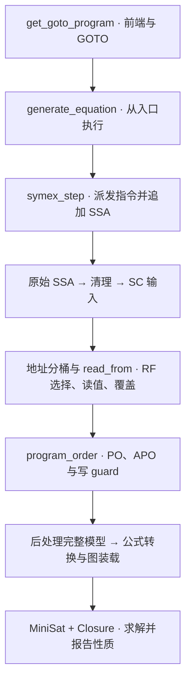

# 阶段 3 · 全量基线、稳定标识和可观测接口

**状态　`READY_FOR_REVIEW`**

## 一、结论

四个病例、八个版本的原目标断言、源位置、展开性质、分类与退出码，在独立 Deagle 基线和开发版全量路径上逐项一致。开发版每个版本又在新进程中构建了一次，八组规范化模型和四份变化报告均可重现。阶段 2 冻结的 `cases/` 目录树仍为 `6d3a21f3`。[逐版本验收](evidence/stage-03/acceptance.json) · [冻结检查](evidence/stage-03/frozen-tests.txt)

| 病例 | 旧版全量结果 | 候选全量结果 | 完整模型事件数，旧 → 新 | 实际派发符号指令数，旧 → 新 |
|---|---|---|---:|---:|
| `batch_total` | 违反目标，62 步 | 有界通过 | 24 → 24 | 73 → 73 |
| `threshold_guard` | 违反目标，74 步 | 有界通过 | 28 → 32 | 82 → 84 |
| `split_counter` | 违反目标，166 步 | 有界通过 | 62 → 50 | 192 → 156 |
| `partial_counter`，独立补充测试 | 违反目标，170 步 | **仍违反目标，156 步** | 62 → 56 | 196 → 176 |

补充候选只把左线程的读取和递增合并到同一互斥区。候选反例中，线程 2 在索引 83 读取快照 0，线程 1 在索引 96 写入 1，线程 2 在索引 109 将旧快照加一，再次写入 1。两次 `join` 后，`harness.c` 第 31 行的 `counter == 2` 失败。本阶段确立了这个候选的全量参照结果。使用旧模型时能否同样检出这个错误，留待实际增量路径建成后检验。[补充版本对](../tests/stage3/partial_counter) · [旧版反例](evidence/stage-03/partial_counter/old/cex0.json) · [候选反例](evidence/stage-03/partial_counter/candidate/cex1.json)

## 二、已完成的工作

独立基线保留阶段 1 的兼容提交 `a159f992`。开发工作树在其上加入观测和会话接口，锁定于 `edd8dfc8`。从补丁重建的 Git 树与该提交相同。从 bundle 在新检出目录构建，再与原开发目录构建逐字节比较，两个可执行文件的 SHA-256 均为 `a5960294056efe0bdd8242054e8a6f2e9f56801901aa7d38ccf52ba6f8360c37`。独立基线仍为 `4566c4ae…839a318a3`。[版本与依赖锁](../configs/stage03.lock.json) · [构建记录](evidence/stage-03/build.json) · [原生补丁](../patches/deagle-stage03-observation.patch) · [Git bundle](../patches/deagle-stage03.bundle)

调试时发现上游 `ar rcT` 在已有薄归档中将新对象追加到末尾。两种构建的对象文件内容相同，归档顺序却导致可执行文件摘要不同。阶段 3 构建入口按 Makefile 顺序重新生成开发树的 `goto-symex.a`。最后的矩阵使用修正后锁定的二进制。另一次早期编译因原生 SSA 没有 `is_input()` 方法退出 2，按实际枚举修正后完成编译。各次构建的返回值与完整日志均已保存。[构建入口](../scripts/stage3/build.sh) · [原始日志归档](evidence/stage-03/full-runs.tar.gz)

在已完成阶段 1 准备的 Ubuntu 仓库根目录运行以下命令。两个输出目录应为新的运行目录。单病例交互可运行 `/usr/bin/python3 -B scripts/stage3/session.py partial_counter --out runs/stage-03/manual-session`，逐行输入形如 `{"op":"LOAD_OLD"}` 的 JSON，各命令的实际往返可对照会话记录。[验收脚本](../scripts/stage3/verify.py) · [交互记录](evidence/stage-03/session-partial.jsonl)

```bash
bash scripts/stage3/prepare_deagle.sh
bash scripts/stage3/build.sh
/usr/bin/python3 -B scripts/stage3/verify.py --out runs/stage-03/replay-local
/usr/bin/python3 -B tests/stage3/probe_model.py --out runs/stage-03/probes-local
```

## 三、可检查证据

原生导出分三处。`raw_ssa.json` 位于符号执行完成、清理开始前，`sc_input.json` 位于清理后、SC 建模前，`full_model.json` 位于后处理完成、送交求解器前。例如补充候选有 268 个原始 SSA 步、342 个后处理步。后处理模型有 56 个事件、56 条 PO、9 条 APO、58 条 RF 边，以及 58 个 `rf-val` 读值条件和 18 个 `rf-some` 读覆盖条件。规范化后共有 324 个公式和边片段。原始文件保存类型化 IREP、guards、线程创建位置、目标与展开性质。可在归档的 `verification/partial_counter/build1/candidate/` 下核对。[原始归档，482 个文件](evidence/stage-03/full-runs.tar.gz) · [逐文件 SHA-256](evidence/stage-03/archive.json)

下表按旧新模型中实际出现的事件和约束计数。“待确认”表示身份能匹配，但某项语义依赖无法核准。为保守起见，变化报告将其列在 `events_changed` 中并注明原因。无法唯一匹配的事件分别进入移除和新增。约束按种类、类型化表达式、归属与依赖组成的指纹比较，并保留相同记录的重数。[可读变化摘录](evidence/stage-03/change-examples.json) · [四份完整变化报告](evidence/stage-03/deltas)

| 病例 | 事件新增 / 移除 | 对应事件有语义差异 / 待确认 | 对应事件指纹相同且可比较 | 约束新增 / 移除 / 结构相同 |
|---|---:|---:|---:|---:|
| `batch_total` | 0 / 0 | 1 / 1 | 22 | 7 / 7 / 106 |
| `threshold_guard` | 8 / 4 | 2 / 1 | 21 | 56 / 33 / 100 |
| `split_counter` | 16 / 28 | 8 / 3 | 23 | 112 / 222 / 165 |
| `partial_counter` | 20 / 26 | 4 / 9 | 23 | 155 / 218 / 169 |

常量例中，`record_batch` 对 `shipped_units` 的写事件保留相同身份，写入值的类型化表达式随乘数从 2 改为 3 而变化。位置探针在写语句前插入空行，身份仍相同，送入 Closure 的位置从 3 变成 4。重复语句探针把同一条语句复制到同一块，两处均被拒绝匹配。展开探针增加一个循环后，原目标返回 `SUCCESS`，`record_batch.unwind.0` 返回 `FAILURE`，适配器报告 `INCOMPLETE_UNWINDING`。循环出现次数以实际回边绑定。[数值写事件和表达式](evidence/stage-03/change-examples.json) · [探针结果](evidence/stage-03/probes.json)

## 四、工具接入与技术选择

在锁定的 Deagle 源码上跟踪了以下调用。实线表示本次全量路径经过的主要环节。恢复执行函数和理论冲突处理位置均已查阅源码，阶段 3 没有从另一程序恢复状态或导入冲突子句。[原生观测插入位置](../patches/deagle-stage03-observation.patch)



- 符号执行入口、`symex_step` 和单程序保存状态的恢复函数使用当前 GOTO 程序。状态包含线程调用栈、L1/L2 命名及指针信息。`path_storaget::patht` 复制方程并重新连接状态，路径存储还管理命名和 dirty 分析。跨版本重绑定这些对象仍需单独验证。[符号执行接口](https://github.com/thufv/Deagle/blob/d8c79eaba5df03b1a013dc6ffbb3a1e249485c1e/src/goto-symex/goto_symex.h) · [执行入口](https://github.com/thufv/Deagle/blob/d8c79eaba5df03b1a013dc6ffbb3a1e249485c1e/src/goto-symex/symex_main.cpp) · [状态定义](https://github.com/thufv/Deagle/blob/d8c79eaba5df03b1a013dc6ffbb3a1e249485c1e/src/goto-symex/goto_symex_state.h) · [路径存储](https://github.com/thufv/Deagle/blob/d8c79eaba5df03b1a013dc6ffbb3a1e249485c1e/src/goto-symex/path_storage.h)
- equation 持有 SSA、事件、边及 guard。SC 根据地址候选写生成 RF 选择、读值和覆盖条件，再构建线程内顺序。构建 APO 时调用 `build_same_line_atomic_set`。原生导出保留其来源分组以及求解器实际收到的写位置。[方程](https://github.com/thufv/Deagle/blob/d8c79eaba5df03b1a013dc6ffbb3a1e249485c1e/src/goto-symex/symex_target_equation.cpp) · [事件分桶](https://github.com/thufv/Deagle/blob/d8c79eaba5df03b1a013dc6ffbb3a1e249485c1e/src/goto-symex/partial_order_concurrency.cpp) · [读值与覆盖](https://github.com/thufv/Deagle/blob/d8c79eaba5df03b1a013dc6ffbb3a1e249485c1e/src/goto-symex/memory_model.cpp) · [SC 顺序](https://github.com/thufv/Deagle/blob/d8c79eaba5df03b1a013dc6ffbb3a1e249485c1e/src/goto-symex/memory_model_sc.cpp)
- 固定参数选择 `deagle_closure_solvert`。BMC 转换方程和图上的 guard，SAT adapter 将子句交给 MiniSat。Closure 在激活边时可生成 `conflict_lv`，传播器读取这组原始原因，之后冲突分析可生成学习子句。本阶段保存可追溯到事件的逻辑约束，在求解前后保留各自原生对象。[后端选择](https://github.com/thufv/Deagle/blob/d8c79eaba5df03b1a013dc6ffbb3a1e249485c1e/src/goto-checker/solver_factory.cpp) · [图与公式转换](https://github.com/thufv/Deagle/blob/d8c79eaba5df03b1a013dc6ffbb3a1e249485c1e/src/goto-checker/bmc_util.cpp) · [SAT adapter](https://github.com/thufv/Deagle/blob/d8c79eaba5df03b1a013dc6ffbb3a1e249485c1e/src/solvers/sat/satcheck_minisat2.cpp) · [理论图](https://github.com/thufv/Deagle/blob/d8c79eaba5df03b1a013dc6ffbb3a1e249485c1e/minisat-2.2.1/minisat/core/Closure.cc) · [传播与冲突分析](https://github.com/thufv/Deagle/blob/d8c79eaba5df03b1a013dc6ffbb3a1e249485c1e/minisat-2.2.1/minisat/core/ClosureSolver.cc)

单病例会话依次响应 `LOAD_OLD → BUILD_OLD → VERIFY_OLD → WAIT_FOR_CANDIDATE → UPDATE_CANDIDATE → VERIFY_CANDIDATE → EXPORT_RESULT → SHUTDOWN`。原版求解后驻留，候选在另一个原生进程中全量构建。会话记录给出每次交互时的 PID、存活状态和最终退出码。串行求解，共用 20 GiB cgroup。协议、求解器日志与官方 JSON 分别输出。提前 EOF 和乱序命令均实测报错并回收进程。[会话实现](../scripts/stage3/session.py) · [补充病例的八次交互](evidence/stage-03/session-partial.jsonl)

## 五、正确性和范围

`VersionManifest` 保存源码、实际 GCC 预处理调用与依赖头文件哈希、内建库输入、原生类型布局、harness、性质、展开、后端及工具链。版本身份包含完整翻译输入，片段比较另查配置和语义依赖。三个主病例及补充病例均固定为 64 位、SC、Deagle Closure、展开界 4 并启用展开断言。八个版本各用同一份输入运行了独立基线、关闭观测的开发版、两次开启观测的开发版。[契约 schema](../schemas/stage3-model.schema.json) · [预处理实录工具](../scripts/stage3/record_gcc.py) · [验收矩阵](evidence/stage-03/acceptance.json)

来源节点依据文件、函数、语句和词法块，GOTO 指令还核对降低后的类型化形状。事件身份加入线程创建点、调用栈、回边与动态出现次数、读写角色和对象。语义指纹另含类型、guard、写入值、原子区、同源分组、顺序邻接及求解器位置。约束把当前模型的 SSA 名和 RF 选择重绑定到语义定义或事件端点，有歧义的绑定单独标出。当前映射针对本次 C 病例的单语句形式。重复语句、同站点的多次线程创建和无法区分的地址实例会扩大失效集合。[映射实现](../incdeagle/model/identity.py) · [事件与约束](../incdeagle/model/observe.py) · [依赖与变化计算](../incdeagle/model/compare.py)

变化报告中的“保留”只计完整构建之间可以核对的结构。每份报告都记录 `checkpoint_used=false` 和 `fallback_reason=stage3_full_only`，并另列受到上游定义变化影响的片段。全程序指针及 dirty 分析尚未建立跨版本有效性证明。检查点恢复、模型片段实际移植、lemma 导入和增量性能实验均留待后续阶段。[补充测试变化报告](evidence/stage-03/deltas/partial_counter.json)

## 六、成本

正式矩阵含 8 次独立基线、8 次关闭观测的开发版验证、16 次带观测的开发版验证。两轮共 8 个完整单病例会话，矩阵与异常协议检查用时 9.4854 秒。本阶段从 10:27:14 UTC 到服务器停止检查共 38 分 47.53 秒，含实现、编译、调试和复跑。构建并行度 4，单版本原生构建与求解合用 300 秒活动预算。归档记录全部分项。DeepSeek 调用 0 次，API 费用 0。[验收计时](evidence/stage-03/acceptance.json) · [构建资源](evidence/stage-03/build.json) · [停止检查](evidence/stage-03/stop-check.json)

以 `batch_total` 旧版带观测的首轮为例，解析/GOTO 139.673 ms，符号执行 1.559 ms，清理 0.428 ms，事件约束 1.538 ms，CNF 与图装载 1.809 ms，目标准备 0.007 ms，求解 0.276 ms，结果输出 0.773 ms，三次方程导出合计 5.984 ms。解析包含预处理记录器，符号执行包含逐指令观测。独立基线该次外层墙钟为 71.7 ms。四个小程序用于验证接口与正确性，实际增量性能留待更复杂并发基准上测量。[各版本两轮分项及独立基线墙钟](evidence/stage-03/acceptance.json)

## 七、下一阶段建议

经确认后，阶段 4 可先用常量例定位检查点恢复与写值失效，再以三个冻结候选和独立的 `FALSE → FALSE` 候选对照全量结果。补充候选的验收条件应包括在新版本、新模型中再次检出同一目标失败。复杂并发基准留到增量路径可运行后选取，届时单独记录原版预热和候选端到端耗时。

本阶段已停止，等待你确认是否进入阶段 4。
