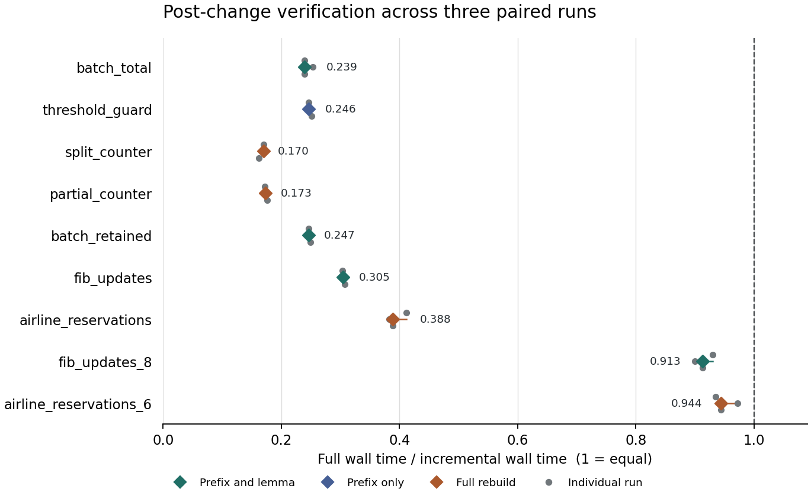

# 阶段 7　并发程序单次修复的正确性与性能对比

状态为 **READY_FOR_REVIEW**。本阶段对 9 个冻结版本对各做 3 次配对测量。5 对来自阶段 6，另 4 对来自两种并发工作负载的不同规模。[试验矩阵](evidence/stage-07/matrix.json) · [逐次测量](evidence/stage-07/measurements.json)

## 一、结论

**验证结果一致，修改后验证在本次测量中均未提速。** 27/27 次配对的确定性结论一致，9/9 个版本对的独立诊断模型通过检查。按不同版本对计，7/9 个候选满足原性质至给定界限，2/9 个仍有错误，两条路径在每次运行中都检出。5/9 对实际跳过原生符号执行前缀，4/9 对向新求解器实际导入旧理论子句。[正确性、覆盖和性能汇总](evidence/stage-07/summary.json)

以 `T_full / T_inc` 为加速比，1 表示两路等时。先取每对三次配对比值的中位数，再给 9 对等权，得到**总体中位数 0.247，几何平均数 0.328**。实际复用前缀的 5 对中位数也是 0.247。27 个单次比值都小于 1。较大规模上，八轮 Fibonacci 的中位数为 0.913，六线程订票为 0.944。[逐次墙钟与比值](evidence/stage-07/measurements.json)



## 二、已完成的工作

服务器逐一复核了阶段 6 的五个版本对，再新增 2 个 Fibonacci 和 2 个订票版本对。两种负载根据已固定的 Yogar `EX1` 基准独立编写。Fibonacci 采用两线程各 4 或 8 次原子加法，在线程均结束后检查分量上界，去除左侧更新多加的 1。订票采用 4 或 6 个售票线程与 3 或 5 个座位，检查所有请求结束时是否填满座位，补丁将读取余量和条件更新放入同一个临界区。上游分别使用每线程 6 次加法和 25 个售票线程，原上界与本项目的终态断言也有区别。较小扩展例的独立全量诊断分别约 0.13 秒和 0.29 秒，因此在正式计时前又冻结了两个规模，四个结果全部保留。[扩展程序与规模定义](../tests/stage7) · [Yogar Fibonacci 原始输入](https://github.com/yinliangze/yogar-cbmc-inc/blob/6e1d4eacf3cccc6634e876e884792bac6115ba82/benchmarks/EX1/bench-origin/fib_safe-6.i) · [Yogar 订票原始输入](https://github.com/yinliangze/yogar-cbmc-inc/blob/6e1d4eacf3cccc6634e876e884792bac6115ba82/benchmarks/EX1/bench-origin/airline-25.i)

每个实验单位绑定 `P0`、冻结的旧反例、`P1`、性质与配置。先在计时外建立一份独立诊断。正式重复中交替安排增量路径与独立全量路径，每轮重新验证旧程序、建立新检查点和理论缓存，所有验证任务串行。使用诊断后自然预热的文件系统缓存。每个求解阶段都受 300 秒、20 GiB 约束。[实际调度顺序](evidence/stage-07/plan.json) · [计时控制器](../scripts/stage7/experiment.py) · [资源与路径边界](../scripts/stage7/worker.py)

**复现。** 在项目根目录可直接执行第一条命令，使用 Python 标准库和 Git 离线重算本报告的数据。第二条在部署好原生工具的 Linux 服务器启动一组新实验，第三条从该组实验生成结构化结果和压缩归档。运行目录使用新的路径，以保留此前的结果。[离线核对入口](../scripts/stage7/check_evidence.py) · [结果和归档生成器](../scripts/stage7/pack.py)

```bash
python -B scripts/stage7/check_evidence.py
python3 -B scripts/stage7/experiment.py --out runs/stage-07/reproduction
python3 -B scripts/stage7/pack.py --experiment runs/stage-07/reproduction --dest runs/stage-07/reproduction-export
```

## 三、可检查证据

下表的墙钟单位为秒，每栏均为三次中位数。“跳过 / 执行”统计候选原生符号执行步数。“导出 / 导入”统计旧求解器原始理论冲突与新求解器生效的旧子句。Fibonacci 四轮导出的 8 条中有 1 条重复，去重后的 7 条全部实际导入。[27 组完整记录](evidence/stage-07/measurements.json) · [原始文件与内容哈希索引](evidence/stage-07/archive.json)

| 冻结版本对 | 候选双路结论 | 跳过 / 执行 | 导出 / 导入 | 全量 P1 | 增量 P1 | 配对比值中位数 |
|---|---|---:|---:|---:|---:|---:|
| batch_total，AI 乘数修复 | 有界通过 | 60 / 13 | 1 / 1 | 0.0812 | 0.3395 | 0.239 |
| threshold_guard，边界条件 | 有界通过 | 61 / 23 | 2 / 0 | 0.0838 | 0.3400 | 0.246 |
| split_counter，合并临界区 | 有界通过 | 0 / 156 | 6 / 0 | 0.0939 | 0.5494 | 0.170 |
| partial_counter，只修左侧 | 仍有违例 | 0 / 176 | 6 / 0 | 0.1042 | 0.6031 | 0.173 |
| batch_retained，错误乘数 | 仍有违例 | 60 / 13 | 1 / 1 | 0.0841 | 0.3408 | 0.247 |
| fib_updates，每线程 4 轮 | 有界通过 | 95 / 88 | 8 / 7 | 0.1196 | 0.3924 | 0.305 |
| airline_reservations，4 线程 | 有界通过 | 0 / 323 | 31 / 0 | 0.2862 | 0.7450 | 0.388 |
| fib_updates_8，每线程 8 轮 | 有界通过 | 95 / 144 | 14 / 14 | 2.4610 | 2.6966 | 0.913 |
| airline_reservations_6，6 线程 | 有界通过 | 0 / 467 | 84 / 0 | 31.4699 | 32.8944 | 0.944 |

**模型与反例。** 每个版本对都用独立的增强版全量运行对照 GOTO、原始 SSA、SC 输入、最终事件及约束模型和结构摘要。计时结束后又对 27 份正式候选复核四个阶段的摘要，全部匹配。对实际恢复的检查点，旧前缀与新后缀的原生分派序列拼接后等于全量序列。例如八轮 Fibonacci 的候选保留 31 个事件、28 条线程内顺序边和 17 条读值或读覆盖约束，重建 54 个事件和 282 条这类约束。对原生导入，核对了旧证书、带符号的 CNF 重绑定和新求解器回执。两例残留错误共得到 12 份候选反例，全部从原始 JSON 重新解析。错误乘数确实写入 10，部分同步修复的右侧读取和两个计数写入符合一个可达交错。该检查覆盖这些可观察读写，完整库级轨迹的受约束重放仍是范围限制。[离线核对实现](../scripts/stage7/check_evidence.py) · [Linux 核对结果](evidence/stage-07/offline-linux.txt) · [Windows 核对结果](evidence/stage-07/offline-windows.txt) · [原始归档](evidence/stage-07/raw-01.zip)

另以独立的有限调度枚举检查扩展性质。Fibonacci 四轮有 70 种线程更新次序，旧版最大分量 88、候选最大分量 55。八轮有 12,870 种次序，对应值为 4,180 和 2,584。订票旧版最终售出量分别可达 1–3 和 1–5，候选所有抽象调度恰好售出 3 和 5。这组计算独立于 Deagle 的 SAT、事件模型与缓存。[调度枚举及结果](evidence/stage-07/schedule-oracles.json) · [枚举源码](../scripts/stage7/oracles.py)

## 四、工具接入与技术选择

从全新检出目录、零个验证器二进制起步，以固定上游 `d8c79eab` 为 Git 种子，应用已发布的源码 bundle，实际重建了独立基线 `a159f992` 和最终原生分支 `incdeagle-stage5` 的 `0be9e216`。使用同一 GCC 11.4、GNU Make 4.3、4 个构建任务和既有 ccache，耗时 12.16 秒。两套配置文件的哈希相同，两份成品各自与原有二进制锁逐字节一致。已用重建出的两份二进制执行额外诊断。[重建回执](evidence/stage-07/build-receipt.json) · [完整构建日志](evidence/stage-07/build.log.gz) · [增强分支源码 bundle](../patches/deagle-stage05.bundle) · [最终代码锁](../configs/stage07.lock.json)

从新的项目检出部署时，先按阶段 1 配置 Ubuntu 的编译与 Python 依赖，然后运行 `bash scripts/stage7/build.sh`。默认从固定上游提交取得源码，也可传入包含该提交的 Git bundle。该入口依次恢复兼容基线、阶段 3 观察接口、阶段 4 检查点与阶段 5 理论审核，再构建两套所需二进制。现场重建使用服务器已有的固定 Git 对象和编译缓存。安装 mini、隔离环境及凭据入口沿用阶段 1 和 6，本阶段重放不需要 API 凭据。[构建入口](../scripts/stage7/build.sh) · [依赖与工具安装](stage-01.md) · [单例修复及 CLI](stage-06.md)

阶段 6 的 `batch_total` AI 补丁同时命中两种复用，阶段 2 的 `split_counter` AI 补丁因同步修改而回退。合计 2 个 AI 补丁中 1 个复用、1 个回退。7 个人工补丁中 4 个复用前缀、3 个回退，3 个实际导入理论子句，2 个仍有错。按修改类型分，4 个常量修改同时命中模型和理论复用，1 个条件修改仅复用模型前缀，4 个同步修改全部回退。传统工具 ConRepair 对原 pthread 互斥输入的解析限制、Liss 的固定依赖限制见阶段 2，本次性能分组中没有来自这两种工具的候选。[阶段 2 工具实测](stage-02.md) · [候选来源与冻结哈希](evidence/stage-07/matrix.json)

## 五、正确性和范围

两路使用同一份候选源码、harness、目标位置和验证参数。全部采用 64 位、SC、Deagle Closure 后端及展开断言，各病例的界限随 `Gamma` 保存。9/9 对的旧版本均违反指定性质。正式结果中，每条路径各有 27 个确定结果，`UNKNOWN`、`TIMEOUT`、`OOM`、`ERROR` 和 `INCOMPLETE_UNWINDING` 均为 0/27。既有三个病例与阶段 3 补充病例的冻结树已核对。上述结论适用于这批有限程序及其界限。[分母与各状态计数](evidence/stage-07/summary.json) · [冻结树检查](evidence/stage-07/stop-check.json)

4/9 对同步修改触发模型完整回退，原生记录分别定位到 `record_one`、`record_left` 和两个规模的 `reserve_seat`。另外，条件变化虽然复用了模型前缀，但事件、边、guard 位置和 atom 绑定的上下文已变化，2 条旧子句全部拒绝。两个订票规模在导出审核时出现 `unmapped_event_visit_or_thread`，31 条和 84 条冲突均无法认证，实际导入都是 0。离线复核重现了该拒绝原因、空绑定计划和零导入回执。合计 5/9 对的旧子句全部失效或无法认证。[回退原因与拒绝分类](evidence/stage-07/summary.json) · [原生审核和回执](evidence/stage-07/raw-01.zip)

## 六、成本

`T_full` 和 `T_inc` 均使用单一外层单调墙钟。增量从准备好的旧会话接收冻结候选前开始，包含源码复制、前端、依赖检查、恢复或回退、子句审核、求解、必要结果与反例解析。独立全量从准备新进程的输入到解析相同性质结束。每次重复另测普通旧验证、带采集的旧验证，以及双方共用的冻结补丁重放耗时。表中周期是各次相加再取中位数。[边界与原始时钟](../scripts/stage7/worker.py) · [全部周期数据](evidence/stage-07/measurements.json)

| 版本对 | 普通旧验证 s | 采集旧验证 s | 全量重放周期 s | 增量重放周期 s |
|---|---:|---:|---:|---:|
| batch_total | 0.085 | 0.271 | 0.178 | 0.618 |
| threshold_guard | 0.085 | 0.281 | 0.176 | 0.628 |
| split_counter | 0.112 | 0.396 | 0.218 | 1.011 |
| partial_counter | 0.113 | 0.399 | 0.224 | 1.010 |
| batch_retained | 0.084 | 0.277 | 0.176 | 0.625 |
| fib_updates | 0.100 | 0.392 | 0.244 | 0.808 |
| airline_reservations | 0.231 | 0.492 | 0.534 | 1.248 |
| fib_updates_8 | 0.184 | 0.709 | 2.653 | 3.412 |
| airline_reservations_6 | 7.815 | 0.855 | 39.798 | 33.745 |

**完整周期的例外。** 六线程订票的增量重放周期较短，差异来自找到旧反例的时间。为排查成因，用新构建的二进制在三种配置下各单独验证同一旧程序一次。独立基线求解耗时 7.089 秒，关闭缓存采集的增强版为 0.226 秒，增强版仅启用观察接口为 0.221 秒。三路均产生 516 步反例，均报告 199,090 个变量和 880,094 个子句。这个旧程序的速度差在关闭缓存采集时已经出现。这一周期收益无法归因于跨版本复用，具体的求解搜索次序差异尚待定位。[三路受控诊断](evidence/stage-07/old-solver-probe.json) · [原始命令、求解消息与反例](evidence/stage-07/old-solver-probe.tar.gz)

**开销位置。** 各例的候选前端外层中位数约 0.214 秒。八轮 Fibonacci 实际复用 95 步并导入 14 条旧子句，候选求解中位数从 2.359 秒降至 2.242 秒，但仍有完整前端、约 0.010 秒变化分析和包含理论绑定的 CNF 与图转换。六线程订票在回退后重建全部 467 步，候选耗时主要落在求解器，基线约 31.32 秒、增量路径约 32.20 秒。现有二进制没有单独导出完整的检查点恢复时间、缓存 I/O 时间或普通全量的纯解析与纯事件建模时间，这些专门字段为 `null`。可取得的原生命名计时保留在明细中，嵌套时间不相加。事件计数对应原生共享读写、派生线程与屏障。约束保留与重建计数对应 SC 的 `rf-val`、`rf-some` 两类公式。[分项、原生计数与缺失字段](evidence/stage-07/measurements.json) · [统计计算](../scripts/stage7/results.py)

**资源与修复。** 8 核亲和集，同一时间运行一个正式任务。CPU 时间来自对应 cgroup 的 `cpu.stat`。组内每 5 毫秒目标采样一次 RSS，求和包含控制器及子进程，共享页可能在多个进程重复计数。明细另存 cgroup 实际记账内存及已回收子进程的单进程内核峰值。以八轮 Fibonacci 为例，旧程序 RSS 中位数由 49.9 MiB 增至 59.4 MiB，候选由 53.4 MiB 增至 84.1 MiB。旧状态一直留在会话中，更新阶段峰值包含旧状态。27 次正式重复的四段主墙钟合计 260.20 秒，9 次额外全量诊断及比对合计 36.98 秒。从本阶段主机采样到阶段停止检查约 33 分 36 秒。[资源采样与阶段快照](evidence/stage-07/environment.json) · [运行与源码核对](evidence/stage-07/host-audit.json) · [停止时间](evidence/stage-07/stop-check.json)

本阶段 API 调用、输入与输出 token、估计费用均为 **0**。若将同一笔已测 AI 修复时间加回两条路径，`batch_total` 完整周期中位数为全量 9.416 秒、增量 9.856 秒。`split_counter` 为 12.164 秒、12.904 秒。前者使用阶段 6 成功修复并封存候选的 9.245 秒，后者使用阶段 2 的模型控制器时段 11.958 秒。阶段 6 的另一次失败尝试及其费用已在原报告计入。人工编写补丁的历史时长缺少记录，表中使用实际重放成本，其人工生成周期字段为 `null`。[历史成本与重放成本](evidence/stage-07/measurements.json) · [阶段 6 调用记录](stage-06.md)

## 七、后续建议

优先检查候选前端的进程等待和可复用输入，以及 CNF 与图编码的全量成本。若继续扩展同步补丁支持，可先为循环创建的售票线程建立可核对的事件身份，再用本阶段两个订票规模检查拒绝条件的变化。至于六线程旧程序的搜索差异，可固定求解器输入顺序，比较首次冲突和决策轨迹。当前交付物保留了相应的输入、原生分支、失败边界与原始记录，可从相同实验单位继续。[阶段状态](../project_state.json) · [原始数据索引](evidence/stage-07/archive.json)

本阶段已停止，等待你决定后续工作。
