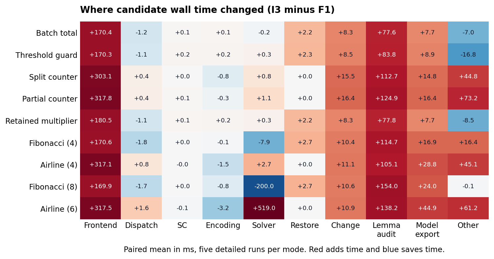
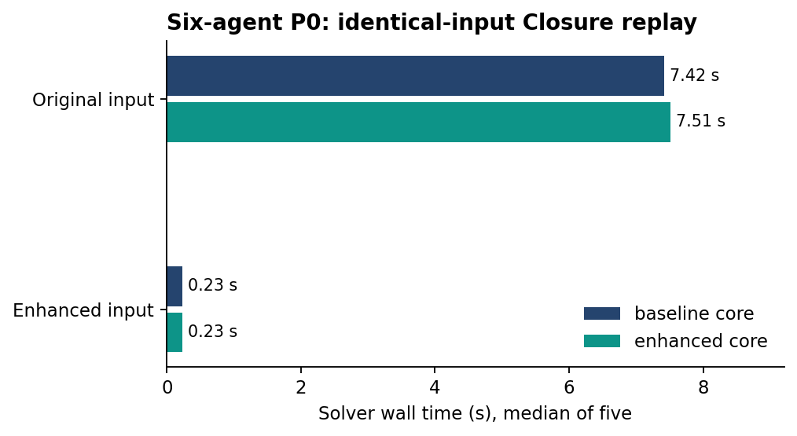
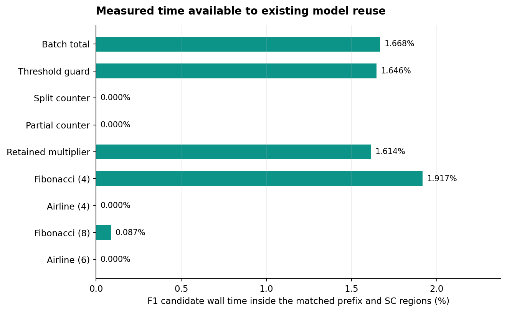

# 阶段 8　增量 Deagle 性能开销归因

**READY_FOR_REVIEW。** 在同一个增强版二进制上，九个冻结版本对的完整增量候选验证 I3 均比全量 F1 慢，配对差中位数为 **128.9～719.7 ms**。45 对普通样本中有 44 对较慢，六线程订票的第 2 对快了 387.8 ms，该次走完整回退，导入数为零。两个修复后仍有错误的候选在所有模式下均被检出。[逐次 CSV](evidence/stage-08/ablation-results.csv) · [六模式及配对差](evidence/stage-08/ablation.md)

## A. 总体判断与关键结论

| 问题 | 判断 | 决定性证据与可信度 |
|---|---|---|
| 1. H1 是否成立 | **成立，限当前建模覆盖范围。** 五个命中病例省略的前缀和可复用 SC 区域，原本只耗 1.310～2.233 ms CPU。历史引理在八轮 Fibonacci 上另有实质收益 | 在 F1 内对确切前 N 次原生分派、相同地址桶和线程分段计量。五个命中病例涉及的墙钟占 F1 的 0.087%～1.917%。九个病例都重新编码并建立新求解器。直接测量，可信度高 |
| 2. H2 是否成立 | **成立。** 即使引理让求解明显变快，当前的前端及会话维护仍超过节省的时间 | 五个重点病例的候选前端外层都约 214 ms，I3 的原生审核器调用为 71.9～108.7 ms，旧缓存另计。F2−F1 的候选总差为 +410.2～+878.3 ms，其中也包含求解波动。受控配对和分相实测，可信度高 |
| 3. H3 是否成立 | **成立。** 六线程订票 P0 的约 7 秒差距可由提交给求解器的有序输入重现 | 原始与增强发布版求解中位数相差 7.023 s。交换完整输入后，两种内核上的差分别为 7.187 和 7.278 s，20/20 次重现对应搜索。同一输入换核的中位数差为 93.0 或 1.8 ms。对输入决定搜索轨迹的判断可信度高，对某一条上游赋值的因果归属仍不足 |
| 4. 最值得先优化哪一项 | **保全依赖记录的前提下，缩短候选前端。** 这是五个重点病例都有的成本，也最接近让真正命中复用的长例跨过盈亏点 | 100 次 GCC 分派对照实测到仅两次标准输入探测就多出 40.6～40.9 ms，三份文件经 Python 记录器多出 95.9～97.1 ms。另有可测的退出发现等待。定位可信度高，实现收益为条件估计 |
| 5. 仅做工程优化能否加速 | **八轮 Fibonacci 有窄幅机会，当前九例尚无总体加速。** 希望在求解主导的长例获得显著加速，需要减少实际搜索工作 | 八轮病例配对缺口 128.9 ms，前端乐观可争取 153.1 ms。同时计及保留的搜索收益，理想零维护估计约 1.095×。六线程订票候选的 F1 求解占比 99.5%。这些为条件估计，尚待实现验证 |
| 6. 哪些工作优先级低 | **单独优化 fork、IREP 文件读写、literal 绑定或扩大目前命中的少量 PO/RF 片段。** 单做 CNF 缓存也很难改变两个长例的量级 | fork 中位数 0.407～0.534 ms。八轮病例读两种 IREP 共 1.369 ms，绑定 0.104 ms，完整 F1 编码及图 11.26 ms。各项均有直接计时。对冻结集的排序可信度高 |

上述判断以同一增强版的普通组候选墙钟为性能依据。详细组用来解释工作量，独立控制用来识别原因。各组均保留五次结果、IQR、极值和离群样本。[原始阶段时间](evidence/stage-08/phase-times.csv) · [可复现的成本估计](evidence/stage-08/engineering-potential.md) · [求解器证据](evidence/stage-08/solver-attribution.md)

## B. 最主要的时间开销

| 实测工作 | 病例与分母 | 时间及占比 |
|---|---|---|
| Closure 求解 | 普通 F1 的 P1 墙钟 | 八轮 Fibonacci 为 2,466.05 ms，占 96.1%。六线程订票占 99.5%。小型 batch_total 仅占 0.3% |
| 候选前端 | 普通 I3 的 P1 墙钟 | 约 214.1 ms，占 batch_total 的 63.1%、八轮 Fibonacci 的 7.9%、六线程订票的 0.6%。回退后还会启动一次完整候选 |
| 理论快照、审核进程及导入 | 详细 I3−F1 独占账本 | batch_total 平均增加 77.6 ms，八轮 Fibonacci 增加 154.0 ms。后者的审核子进程中位数 108.7 ms，内部纯证书检查 3.045 ms。审核器的启动、退出和外层剩余占 60.6 ms |
| 旧证书构造 | 八轮 Fibonacci 的 P0 采集 | Python 证书构造独占中位数 257.0 ms，约占该例普通 I3 旧程序 713.5 ms 的 36%。这一项属于修复周期，单独计算 |
| 同步修改回退 | 四个回退病例的普通 I3−F1 | 扣掉对应求解时间差后的非求解差为 498.8～541.9 ms，包括候选预检、重复构建、快照及控制器收尾。这是提前选择全量时可争取的量级 |

214 ms 可进一步核实。以 batch_total 为例，观察器外层 214.06 ms，pidfd 观测到进程寿命 196.54 ms，退出发现尾部 17.60 ms。用系统 GCC 时，原生 C/GOTO 父阶段为 42.97 ms，约为原外层的 20.1%，其中预处理 20.99 ms、C 解析 8.33 ms、类型检查 3.08 ms。GOTO JSON 输出 1.63 ms，IREP 写出 1.50 ms。三个文件输入另有两次经标准输入的 C/C++ 配置探测，合计五次 GCC 进入。独立 strace 及四种包装器配置核对了这一区别。所列父阶段与子阶段有包含关系。[前端 225 次独立控制及系统调用](evidence/stage-08/frontend-attribution.md) · [缓存、变化、I/O 与审核明细](evidence/stage-08/maintenance.md)



## C. 真正省下的计算

**符号执行和 SC。** 八轮 Fibonacci 从 239 次原生分派中保留了 95 次，其原始 CPU 中位数为 2.035 ms。保留的线程及地址区域原始生成 CPU 为 0.122 ms。另有 144 次分派、54 个事件、102 条 PO/APO 边、244 条 RF 边和 282 条读值或读覆盖公式仍需处理。受控关闭 SC 复用后会重新生成相应约束，同一二进制 I2−I1 的候选配对差为 −0.2 ms。batch_total 避免 60/73 次分派，仅对应 1.262 ms 的原前缀 CPU。区域级计时不能再分解为单条 PO、RF 或覆盖公式的精确占比。[九例建模覆盖与 CPU](evidence/stage-08/case-costs.md)

**理论引理和搜索。** 八轮 Fibonacci 的 I2 和 I3 在导入前捕获的 1,157,252 字节输入完全相同，图和 guard 顺序一致。I3 实际导入 14 条，决策从 64,162 降至 58,467，冲突从 23,391 降至 21,478，传播从 28,464,737 降至 27,765,733，重启从 84 降至 76。配对求解墙钟少用 189.2～224.4 ms，中位数 217.7 ms，候选外层中位数省 199.9 ms。审核在两种模式中都执行。四轮 Fibonacci 导入 7 条，求解配对中位数少用 8.3 ms。无导入的六线程回退仍出现约 106 ms 的 I2/I3 求解波动，因此零命中时不记引理收益。[求解时间、计数和完整输入对照](evidence/stage-08/solver-attribution.md)

**二进制差异。** 六线程旧订票程序的三组发布版求解中位数为原始 7.259 s、增强普通 0.236 s、增强仅观察 0.235 s。三组报告的变量和子句总数相同。实际提交的 910,797 条子句中有 2,537 个序列位置不同，忽略子句内 literal 次序后，每侧仍有 2,533 条无法按相同数字编号匹配。变量分配记录和 997 行图及 guard 顺序相同。六线程旧程序打印的 821 个 SSA 步骤有 48 个位置不同，首处在创建新线程时复制栈帧局部变量。控制实验已经把主要差距定位到求解输入，精确到单个 SSA 赋值、单个 SAT 变量语义映射或某一种内存布局的归因仍缺一个单因素实验。[发布版分次数据](evidence/stage-08/old-search.csv) · [有序记录及首次分歧](evidence/stage-08/solver.json) · [固定源码比较](evidence/stage-08/native/solver-release-sources.diff)



## D. 性能上限与摊销

对每个详细 F1 样本取总墙钟 (T) 及命中前缀和 SC 区域原先占用的墙钟 (S)。令维护免费，保持其余工作和搜索轨迹相同，仅消除这两项，Amdahl 上限为 **T/(T−S)**。五个命中病例为 **1.00087×～1.01954×**，四个同步回退病例为 1.00000×。八轮 Fibonacci 的 39.7% 分派覆盖只对应 **0.087%** 的全量墙钟。若更激进地令编码与求解之外的一切工作免费，两项照旧，八轮和六线程订票上限分别为 1.037×、1.004×。引理若改变搜索，后一个前提随之改变。[逐例上限和假设](evidence/stage-08/bounds.csv)

对八轮病例，仅消除五组前端对照所界定的全部工程差额，估计最多可使 I3 由慢 128.9 ms 变为快约 22.4 ms。22.4 ms 是先在每个重复号内扣除该次工程差额，再取五次中位数所得。对 batch_total 和 threshold_guard，同一估计下仍慢约 104.6 ms 和 103.2 ms。旧缓存的额外 P0 配对中位数为 186.3～534.9 ms，驻留检查点 PSS 为 11.4～12.0 MiB，私有页为 10.9～11.4 MiB。九例的候选配对中位数均无净节省，所以当前没有有限的重复使用摊销阈值。每次实际从 P0 开始，未运行连续修复。[工程空间与摊销](evidence/stage-08/engineering-potential.md) · [旧验证、完整周期及内存](evidence/stage-08/ablation.md)



## E. 优化路线与风险

优先级以能否让已支持的真实增量更新获益为首要目标。若只追求降低已知不支持修改的单次延迟，第二项的单例绝对空间更大。以下收益均为**基于实测的估计**，相互重叠的上限不能相加。

| 优先级与改动位置 | 实测依据、预计收益与范围 | 实现代价、正确性条件与验证 |
|---|---|---|
| **1　缩短前端包装与退出等待**。阶段 4 `session.run_pair` 的 `start` 和 `compiler.wait`、阶段 3 `record_gcc.py`、Deagle 的 GCC 配置探测 | 五个重点病例的记录器较系统 GCC 增加约 135～138 ms 进程寿命，另有 13.7～17.6 ms 退出发现尾部。合计乐观空间 151.5～154.7 ms。适用于恢复及回退两条路径 | 难度中等。可合并重复的解释器启动，在进程退出时立刻唤醒控制器。依赖内容、宏、命令、类型布局、头文件和生成单元身份都必须保留。可能需短期保存依赖摘要并增加少量内存。复跑全部九例，并对头文件、宏和编译器版本失效做单独测试 |
| **2　对可确定拒绝的同步修改提前走同一增强版全量**。阶段 4 `change_provider.changes`、`session.candidate_context/run_pair` 和候选提交入口 | 四个同步修改的非求解差为 498.8～541.9 ms，构成候选直接走全量的工程上限。初始 P0 采集成本已经支付。完整重建能保留这些病例的全部求解覆盖 | 难度低至中等。规则只可触发保守拒绝。误拒损失潜在命中，漏识别仍须执行全部现有准入检查。只需临时持有补丁及上下文。对宏、别名、注释、部分同步修复和七个有界通过、两个残错候选逐一核对目标及原生模型 |
| **3　减少证书审核器的进程与序列化成本**。原生 `theory_lemma.cpp::run_audit`、`prepare_order_lemma_cache` 和 Python `incdeagle.theory.cache.bind/validate` | 九例候选审核器外层减其内部 bind 函数为 58.9～60.9 ms。八轮候选另有 29.0 ms 子进程内 JSON 读写。优先尝试同一会话内复用审核进程，JSON 工作只有消除重复传输的部分可能节省。P0 构造证书的 257.0 ms 应另列，不能提前记成节省 | 难度中等。常驻进程会占内存，跨病例状态泄漏和绑定串用是主要风险。状态需按版本、schema、后端和语义快照隔离，保持每条证书、指纹、带符号绑定和原生回执。测试拒绝、破坏缓存、零导入、14 条导入、连续独立会话及峰值 PSS |

阶段 8 保留了生产路径对证书、性质和回退条件的原有核验。上述三个方向都没有作为性能优化提交。[前端控制](evidence/stage-08/frontend-attribution.md) · [分项及非求解差](evidence/stage-08/engineering-potential.md) · [维护成本](evidence/stage-08/maintenance.md)

## F. 下一阶段建议与验收标准

建议下一阶段只先实施第 1 项。**以下数值是建议的验收门槛。** 五个重点病例各至少五次同二进制、交替顺序、无详细探针的对照。候选前端中位数由约 214 ms 降到 **不超过 110 ms**，每例至少节省 **100 ms**。报告 I3 端到端的配对分布及 P0 周期，单列八轮 Fibonacci 是否跨过同版 F1。九例的目标、展开结果、四阶段模型、两例残错反例、真实复用数及拒绝原因必须通过复核。另测编译器配置和头文件变化时的失效，保留超时、退出码和进程回收行为。前端指标达标但候选仍慢时，按实测结果评审，再决定是否投入第 2 或第 3 项。

### 复核条件与证据入口

- 项目基线为 `247894bf77904bb34e547b5a636b8afe8527add4`，原始 Deagle 为 `a159f992`，增强版为 `0be9e216`。全部诊断在独立阶段 8 工作树中完成。正式 F1、F2、I1、I2、I3 均使用 SHA-256 以 `4b7eb552` 开头的同一增强诊断二进制。普通 F0 保留原始发布版。两原生构建配置的 SHA-256 相同，使用 GCC 11.4.0。阶段 7 归档的 3,567 份文件、27 次配对、12 份残错证据先行复核，通过后才开始正式矩阵。[环境及九组锁](evidence/stage-08/environment.json) · [构建与源码指纹](evidence/stage-08/native/native-provenance.json) · [原始探针补丁](evidence/stage-08/native/baseline.patch) · [增强探针补丁](evidence/stage-08/native/enhanced.patch)
- 单个服务亲和集为 8 核，内存上限 20 GiB，P0、P1 各有 300 s 界限。正式阶段串行完成 9 × 6 × 5 × 2 = 540 次 P0/P1，形成 27,870 条分相观测。总历时 3,043.34 s，其中正式服务合计 2,667.74 s。普通及详细数据都保留。八轮 I3 开启探针的配对墙钟中位数增加 50.8 ms，四轮增加 50.6 ms（12.9%），绝对值和是否跨过等待轮询边界因病例而异。首次执行曾遇到已结束的 cgroup 在采样期间被系统移除，保留了未完成尝试和重试，540 个完成回执均校验成功。[调度表](evidence/stage-08/plan.json) · [扰动与异常值](evidence/stage-08/diagnostic-overhead.json) · [停止检查](evidence/stage-08/stop-check.json)
- P0 全部违反原目标。P1 有七例在给定界限内通过、两例继续违反原目标，正式组保留 120 份候选残错见证。360 次控制器候选各与独立全量模型核对 GOTO、原始 SSA、SC 输入、最终方程。另对九组 F1 和九组独立 F0 观察方程取证。仅允许 TLS 常量排列时，F0 的两例匹配、七例仍有顺序差异。复核将比对限定到同一 spawn、同一 guard 和 PC 下相邻的隐藏单赋值，检查等式、目标唯一、右值和 guard 与本块写集不相交，保留每个表达式、线程、性质和边。九例均通过，初始失败回执及逐块证明都归档。有限模型和见证投影的覆盖不构成一般健全性证明。[完整 F0 模型证书](evidence/stage-08/structural-checks.json) · [检查实现](../scripts/stage8/structural.py)
- 所有候选来自冻结补丁。阶段 8 DeepSeek 调用、输入和输出 token、费用均为 0。旧程序和候选时钟分开，报告的重放周期使用当次补丁重放时间。历史 AI 成本只在有原始记录的两个病例提供。保留 39,914 个原始路径、19,911 份不同内容，八个分卷共 112,957,087 字节。归档包含正常与调试输出、未完成尝试、编译日志、IREP、输入流及反例。每个分卷、数据块与逻辑文件都有 SHA-256，可离线重算。[计时边界](evidence/stage-08/timing-boundaries.md) · [归档索引](evidence/stage-08/raw-index.json.gz) · [核验入口](../scripts/stage8/check_evidence.py)

从本提交复核已发布数据，执行以下命令。Linux 重跑需要阶段 7 固定版本的两套原生发布程序、systemd/cgroup v2、strace 及阶段 1 的构建依赖。在独立的新项目检出中，第二、三条命令构建工具并创建新的诊断工作树。绘图使用 Matplotlib。

```bash
python -B scripts/stage8/check_evidence.py
bash scripts/stage7/build.sh
bash scripts/stage8/reproduce.sh runs/stage-08-reproduction
```

Linux（Python 3.10.12）和 Windows（Python 3.13.12）分别从同一套原始归档重算，18 份表格、统计和归因说明逐字节一致。跨版本复核初次发现九项未归因时间的浮点求和末位不同，最大差约 1.5 × 10⁻¹² ms。统计脚本固定了与测量主机相同的加法顺序，两端均重新通过。[Linux 核验回执](evidence/stage-08/offline-linux.txt) · [Windows 核验回执](evidence/stage-08/offline-windows.txt) · [交付文件指纹](../configs/stage08.lock.json)

[全部模式的候选时长图](evidence/stage-08/ablation.png) · [每例时间账本](evidence/stage-08/case-ledgers.csv) · [复现脚本](../scripts/stage8/reproduce.sh)

本阶段已停止，等待你确认是否进入阶段 9。
