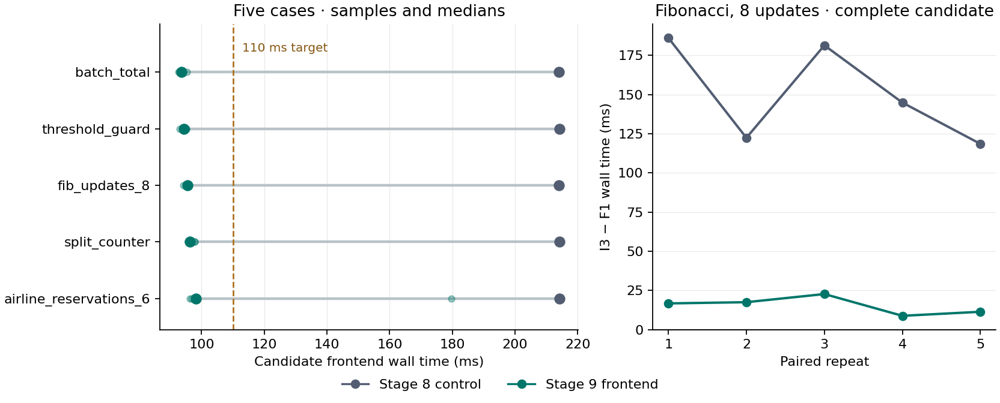

# 阶段 9　候选前端性能优化

**READY_FOR_REVIEW**　五个重点病例的前端均达到两项预设目标。八轮 Fibonacci 的完整候选验证仍比独立全量慢，五次配对差为 +8.8～+22.7 ms。九个版本对的目标、模型和复用结果与冻结对照一致。

阶段 8 诊断固定在 `edd7386f8674eb5db08593d327256ea874bf05f6`，阶段 7 正式基线固定在 `247894bf77904bb34e547b5a636b8afe8527add4`。本阶段使用独立分支 `stage-09-frontend`，预先提交方案 `2f6e7337`，生产补丁提交 `26d0859b`。修改集中在 GCC 记录与候选前端退出通知。所有比较使用同一个 SC/Closure 引擎。[实施前方案](evidence/stage-09/implementation-plan.md) · [生产源码补丁](../patches/stage09-frontend.patch) · [记录字段与迁移规则](evidence/stage-09/differences.md)

## A. 候选前端目标

| 病例 | 旧前端 ms | 新前端 ms | 配对节省 ms | 同版 F1 候选 ms | 新 I3 候选 ms | 新 I3−F1 配对差 ms |
| --- | ---: | ---: | ---: | ---: | ---: | ---: |
| `batch_total` | 214.1 | 93.6 | 120.5 | 80.4 | 221.1 | 140.4 |
| `threshold_guard` | 214.1 | 94.4 | 119.7 | 82.2 | 222.5 | 139.7 |
| `fib_updates_8` | 214.1 | 95.5 | 118.6 | 2,562.8 | 2,580.2 | 16.7 |
| `split_counter` | 214.1 | 96.2 | 117.9 | 92.0 | 483.8 | 391.9 |
| `airline_reservations_6` | 214.1 | 98.2 | 116.0 | 33,325.8 | 33,684.0 | 307.3 |

正式普通组为每例五个重复号，每号各跑优化前后 F1 和 I3，共 100 次完整 P0/P1。四种组合轮换顺序，使用同一测量锁。前端为 I3 候选启动到前端完成的墙钟，新版含身份准备及收尾复查。独立取各组中位数，差值先按重复号计算。五例分别达到 ≤110 ms 和 ≥100 ms 的目标，配对节省为 116.0～120.5 ms。六线程订票有一次前端耗时 179.7 ms，已计入中位数和波动统计。另有 50 次独立插桩前端，用来分解开销。[逐次墙钟与资源](evidence/stage-09/trials.csv) · [五例汇总、范围与离群样本](evidence/stage-09/performance.md)

每次仍执行两个真实 GCC 标准输入探测和三个文件预处理。按五个病例的分项中位数，从原生边界估算，C/GOTO 计算在新前端占 45.7～47.8 ms。五次包装器扣除实际 GCC 的合计从 136.8～137.2 ms 降到 25.6～26.0 ms。新版计算并写依赖记录需 11.3～11.5 ms，准备身份与分派器需 4.1～4.2 ms。原先退出发现延迟为 8.8～12.3 ms，用 pidfd 后为 0.018～0.026 ms。独立观察线程和控制器可能按不同次序被唤醒。实际 GCC、依赖计算、GOTO 与包装器区间有嵌套，分项不可相加。[计时边界及绝对用时](evidence/stage-09/frontend-breakdown.md) · [分项原始读数](evidence/stage-09/frontend-profile.csv)



## B. 完整增量验证与八轮 Fibonacci

八轮 Fibonacci 的 I3−F1 候选配对中位数由 **+144.8 ms** 降到 **+16.7 ms**。优化前五次为 +186.1、+122.4、+181.3、+144.8、+118.5 ms，优化后为 +16.7、+17.5、+22.7、+8.8、+11.4 ms。新版快于 F1 的次数为 **0/5**。同例 I3 前端配对节省 118.6 ms，I3 完整候选相对旧 I3 配对节省 115.9 ms。阶段 8 原冻结实验的配对差为 +128.9 ms。本阶段以交替重跑旧控制器所得的差为比较基准。[五次求解与输入对照](evidence/stage-09/fibonacci.md) · [阶段 8 工程空间估计](evidence/stage-08/engineering-potential.md)

八轮的 14 条历史子句在优化前后均完成审核、带符号重绑定并实际导入。F1 和 I3 在各自模式内，优化前后的有序输入字节、理论图、CNF 提交摘要、首段搜索轨迹和最终计数均一致。I3 每次的决策、冲突、传播分别为 58,467、21,478、27,765,733。F1 对应为 64,162、23,391、28,464,737。新版 F1 与 I3 求解墙钟中位数为 2461.7 和 2264.9 ms，配对节省 199.0 ms。剔除这项求解时差后，候选路径仍有约 214.3 ms 配对额外成本。引理与求解时间的因果拆分沿用阶段 8 的同输入消融。[求解输入与搜索哈希](evidence/stage-09/solver-inputs.json) · [阶段 8 求解器归因](evidence/stage-08/solver-attribution.md)

完整修复周期逐次计入 P0 准备、冻结补丁实际重放和 P1 验证。为验证候选身份，P0 同时获取真实探测、头依赖和编译器身份，五例的 P0 配对增量为 40.5～47.6 ms。八轮 I3 周期由 3424.8 变为 3348.9 ms，优化后同版 F1 周期为 2748.1 ms。六线程订票新版五次仅 1/5 快于 F1，配对差从 -239.6 到 +1360.4 ms，单次交叉不足以证明稳定加速。该例新版 I3 相对旧 I3 的完整候选配对中位数增加 436.6 ms，完整周期增加 475.9 ms。其余四例的 I3 完整周期配对缩短 72.9～78.3 ms。两版 F1、I3 的 P0、P1、完整周期与离群样本均保留。[各例性能及波动](evidence/stage-09/performance.md) · [配对分布](evidence/stage-09/paired.json)

## C. 正确性、缓存与资源

九例各跑两版 F1/I3，共 36 次深度回归。每次从原始结果重建目标和展开判定。核对 68 份 I3 及 18 份独立全量模型的 GOTO、原始 SSA、SC 输入及最终模型。原生恢复的分派序列与独立全量顺序一致，SC 线程顺序边及 read-from 约束的复用数与阶段 7 相同。68 次 I3 重新核算证书、绑定和原生导入回执。七个候选有界通过。`partial_counter` 和 `batch_retained` 均检出原断言违反，重建 8 份候选反例。四个同步修改均按同步调用变化整例回退。正常发布版 CLI 在 `batch_total` 和八轮 Fibonacci 上也分别实际导入 1 与 14 条子句，并通过独立全量模型检查。[九例原生计数与回退原因](evidence/stage-09/regression.md) · [CLI 回执](evidence/stage-09/production-cli.json)

同一路径的 9 组 GCC 对照逐字节比较 stdout、stderr 和退出码，原记录器产生的七字段逐项相等。正式与深度测量另比较 68 对 P0/P1 记录，包括实际头依赖、源文件摘要、规范化预处理结果和原有 manifest。临时路径经不同运行生成时，分别保存原始流并在同次调用中核验原始哈希。源码、生成单元、配置、GOTO 类型布局和工具链身份参与准入。独立副本改动头文件、宏选项、编译器后端、结构体、嵌套包含或加入未知来源时，均拒绝旧缓存。使依赖附件缺失或改写已记录 stdout 也被拒绝。上述拒绝均跳过 0 步、导入 0 条，候选结论与另起全量进程相同。别名头的两种路径解析到同一文件，最终原生路径为 `incremental`，跳过 60 步、导入 1 条。语法错和 GCC 非零退出均在正常 CLI 返回 `INVALID_PATCH`。另实测了到期清理进程组、拒绝错误内存上限及独立 cgroup OOM。[等价性逐项回执](evidence/stage-09/gcc-equivalence.json) · [12 项负向与资源控制](evidence/stage-09/negative-results.json)

额外记录器运行在现有控制器进程中。结束后核查 170 个分派器 PID 和 68 个前端 PID，均已退出。八轮候选 I3 的 cgroup CPU 时间中位数从 2673.0 降至 2563.9 ms。进程 RSS 采样峰值中位数从 85.8 变为 79.8 MiB。新增组件不跨会话驻留。每个新版候选分派目录保留原始预处理等附件，五例的样本中位数约 90.8～95.1 KiB，计入证据磁盘成本。另表给出所有模式 P0/P1 的 CPU、RSS、cgroup 内存及峰值进程数。[资源表](evidence/stage-09/performance.md) · [停止检查](evidence/stage-09/stop.json)

## D. 后续优化优先级

若后续获批，建议优先让已确认不支持的同步修改提前进入完整验证。优化后的 `split_counter`、`airline_reservations_6` 在扣除实测求解差后，I3 对 F1 的配对额外开销仍为 390.8 和 407.9 ms。这些路径实际导入和前缀跳过均为零。适用面是九例中的四个同步修改。若目标仅限八轮 Fibonacci，下一项可单独评估证书审核子进程的启动与传输。阶段 8 在八轮测得其外层余量约 60.6 ms，本轮八轮差额为 16.7 ms。两者都是下一轮的测量假设，提前分流仍需验证候选，审核仍须逐条检查。两项均未在本阶段实施。[分布与剩余开销](evidence/stage-09/paired.json) · [审核器原测量](evidence/stage-08/engineering-potential.md)

## 构建、复核与实验边界

正式组 CPU 亲和集 0～7，每个验证程序 300 秒，cgroup v2 上限 20 GiB，GCC 11.4.0，Python 3.10.12，内核 5.15.0-186-generic。使用阶段 8 原增强诊断二进制，SHA-256 为 `4b7eb552662481b244937b46cfbf85b0362d4339cbe0f82fccbee6cfdc3c299b`，普通组关闭额外诊断，结构组开启。发布 CLI 另用阶段 5 固定二进制。补丁、候选、harness、性质、反例与界限沿用阶段 7 的哈希。旧状态与新状态每次重新建立，操作系统文件缓存未清空。每例五次只描述本服务器、该界限和冻结补丁。DeepSeek 调用为零。[构建证据](evidence/stage-09/environment.json) · [五个生产文件指纹](evidence/stage-09/controller-sources.json) · [冻结版本对](evidence/stage-07/matrix.json)

已发布证据可在仓库根目录离线重算。重新测量时使用两个独立检出。阶段 8 检出须固定在前述提交，两个检出均按阶段 7 部署发布工具。阶段 8 的构建入口生成增强诊断程序及本机绝对路径的 `lock.json`。构建依赖、命令和诊断工作树创建见既有发布记录。[阶段 7 发布工具](stage-07.md) · [阶段 8 构建入口](../scripts/stage8/build.sh) · [诊断工作树创建](../scripts/stage8/reproduce.sh)下例的 `S8`、`S7_DATA`、`S8_LOCK` 均指向对应主机上的真实路径。若需恢复阶段 7 的原始数据，可在空目录调用 `scripts.stage7.check_evidence.restore`。

```bash
python -B scripts/stage9/evidence.py
systemd-run --wait --pipe --collect -p "WorkingDirectory=$PWD" -p MemoryMax=21474836480 \
  /bin/bash scripts/stage9/reproduce.sh "$S8" "$S7_DATA" "$S8_LOCK" "$PWD/runs/stage09-reproduction"
python -B scripts/stage9/plot.py reports/evidence/stage-09
```

归档包含 25,482 个原始路径、5 个分卷。Linux 和 Windows 从原始分卷重算并和发布的 CSV、JSON、Markdown 逐字节比较。分卷还保存先期开发测量、第一次保守回退的预试及修正后的重试。正式结论只取最终五个生产源文件校验通过的独立检出。另用独立 CSV 工作簿读取器核对 136 行、90 个中位数和 50 个配对差。复现脚本保留每次运行的原生输出、资源采样、GCC 记录和模型。[原始分卷索引](evidence/stage-09/raw-index.json.gz) · [Linux 重算](evidence/stage-09/offline-linux.txt) · [Windows 重算](evidence/stage-09/offline-windows.txt) · [开发对照](evidence/stage-09/development.json) · [构建与运行脚本](../scripts/stage9/reproduce.sh) · [阶段 9 文件锁](../configs/stage09.lock.json)
